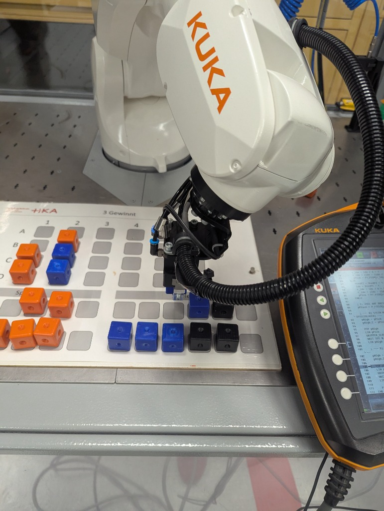
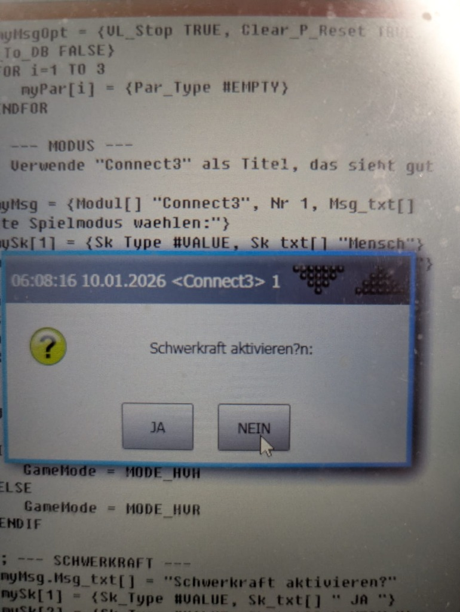
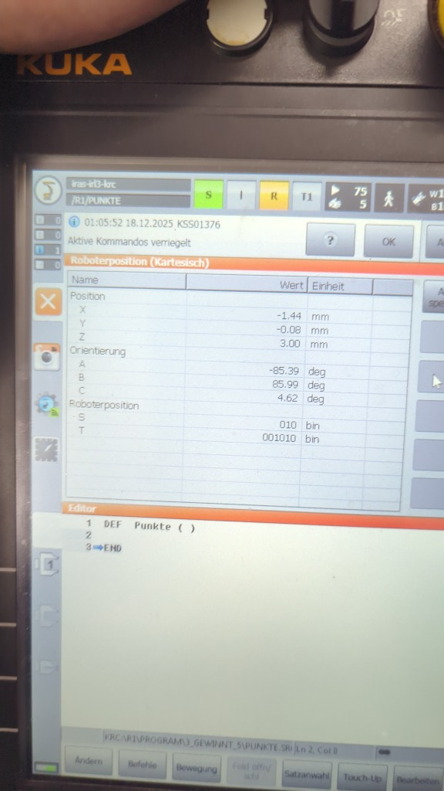
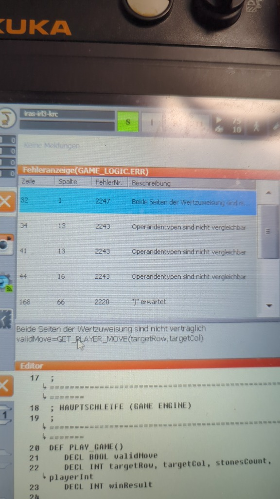
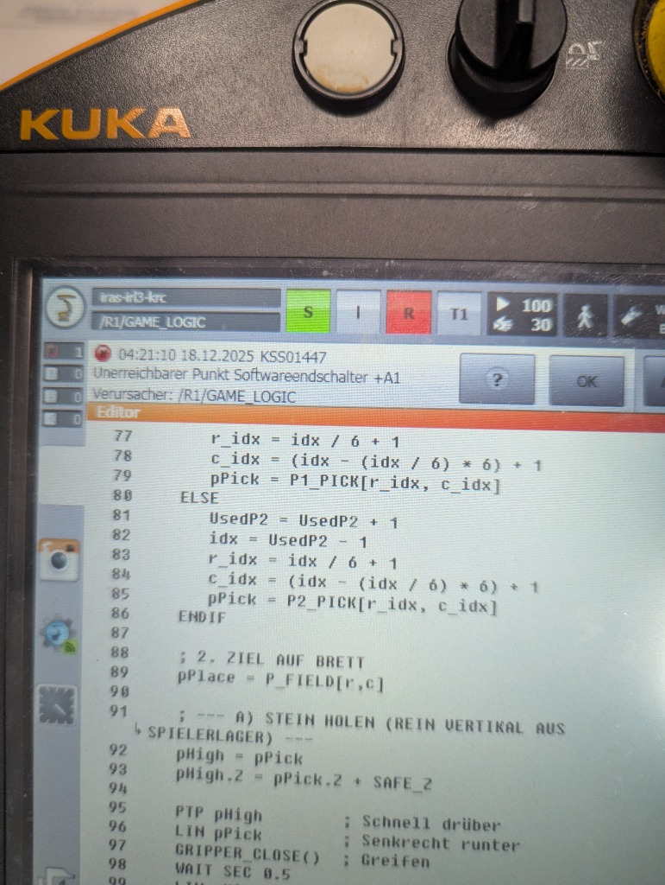
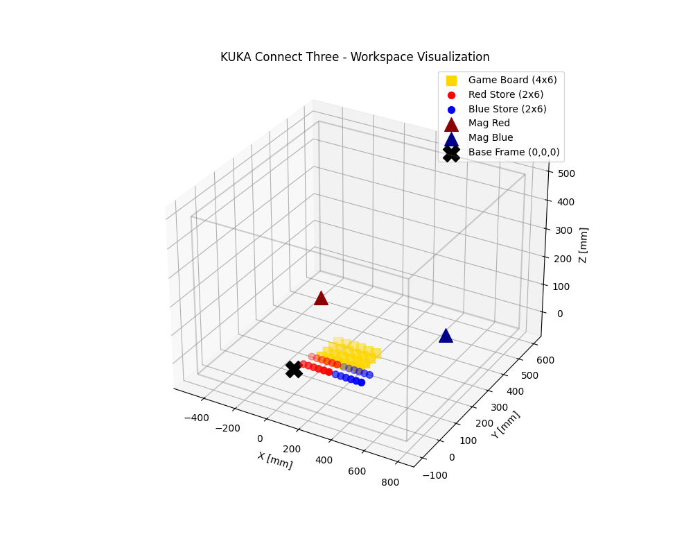
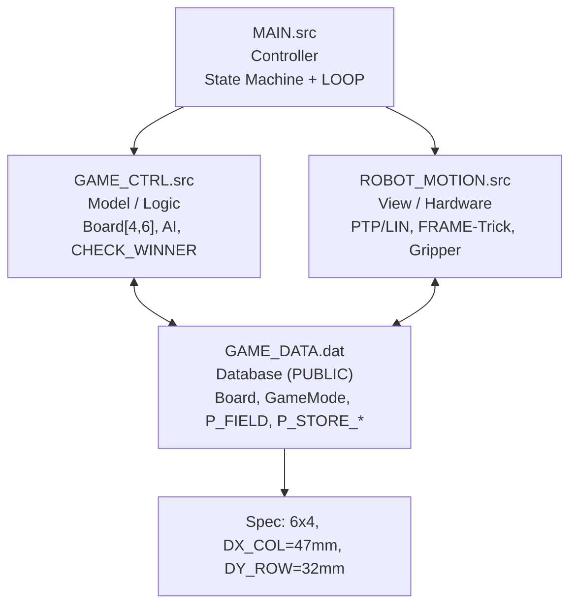

# 🤖 KUKA Connect Three — Autonomous Game on KRC4

> **Industrial robotics meets game AI.** A complete KUKA KRC4 application where a 6-axis industrial robot plays *Connect Three* autonomously — modular KRL, real-world kinematics, three distinct game modes & AI. <br> *Schwerpunkt: KRL-Robotercode & Spielmodi — Simulation nur als leichtes Preview.*

[](https://www.kuka.com)
[]()
[](https://www.python.org)
[](https://flask.palletsprojects.com)
[](https://threejs.org)
[](LICENSE)
[]()

**Hochschule Karlsruhe (HKA) — Fakultät Wirtschaftswissenschaften · Wirtschaftsingenieurwesen · Robotics Lab · WS 2025/26** · Louis · Marius Keck · Julius

---

### ✨ TL;DR — Why this repo matters for robotics

| Competency | Demonstrated here |
|---|---|
| **KRL (KUKA Robot Language)** | 4 modular `.src/.dat` programs, `E6POS`/`FRAME` kinematics, `BAS`, `PTP`/`LIN`/`SLIN`/`SPTP`, I/O gripper control |
| **Kinematics & Calibration** | `BASE_DATA[14]` / `TOOL_DATA[14]`, taught points, `DX_COL`/`DY_ROW` grid math, Status & Turn handling |
| **Motion Planning** | Collision-free `APPROACH_Z`, `SAFE_Z`, retract logic, posture-aware `FLIP_THRESHOLD_COL` for wrist singularity avoidance |
| **System Architecture** | Layer model (Controller / Logic / Motion / Data), `PUBLIC` data separation, linker-safe modular design |
| **AI / Game Theory** | 4-stage heuristic (win → block → center → fallback), gravity simulation, `CHECK_WINNER` in 4 directions |
| **Simulation (Preview)** | Lightweight Flask + Three.js preview of the KRL logic — one image below, full code in `simulator/` |
| **Quality & Safety** | T1/AUT validation, collision tuning, stress tests (5× RvR games), full documentation & presentation |

---

## 📸 Gallery & Demo

### 🎥 Demo Video — Real KUKA KRC4 Cell

<p align="center">
  <a href="https://github.com/marius788/kuka-connect-three/releases/download/v1.0/kuka-demo.mp4">
    
  </a>
</p>
<p align="center">
  <em>Full autonomous game + cleanup — 6×4 board, gravity mode, 12 red + 12 blue stones, SmartPad dialogs. Click the image to play/download (92&nbsp;MB MP4, no login required).</em>
</p>

<p align="center">
  <a href="https://github.com/marius788/kuka-connect-three/releases/download/v1.0/kuka-demo.mp4"></a>
  <a href="https://drive.google.com/file/d/11IhQFTRbLN98H1OE9pHZy4h9QzOdAfaD/preview"></a>
  <a href="docs/Dokumentation_V2.html"></a>
</p>

> **No YouTube yet?** The Drive link is a 1-click preview (`/preview` embed). For LinkedIn/portfolio, upload to YouTube as *unlisted* and replace the image link with `https://www.youtube-nocookie.com/embed/YOUR_ID` — see `docs/videos/README.md`.

<details>
<summary><b>📖 Video details & alternative playback</b></summary>

- **Source:** `Video von marius keck` (original 92 MB MP4, `00 00 00 18` MP4, H.264) — recorded on the HKA KRC4 cell in AUT mode
- **Also embedded in:** [`docs/Dokumentation_V2.html`](docs/Dokumentation_V2.html) via Drive iframe, plus thumbnail `assets/images/Video Demo.jpg`
- **Direct HTML5 (try in browser):**
  ```html
  <video controls poster="docs/images/image4_roboter_setup.jpg" width="100%">
    <source src="https://github.com/marius788/kuka-connect-three/releases/download/v1.0/kuka-demo.mp4" type="video/mp4">
  </video>
  ```
  GitHub README sanitizes some `<video>` tags — the **image-link above is the reliable fallback** and works everywhere (GitHub, LinkedIn, PDF export).
- **YouTube guide:** `docs/videos/README.md` → upload → replace href.

</details>

### 🖼️ Hardware Impressions

| Robotic Cell | SmartPad Dialog | Cartesian Position |
|---|---|---|
|  |  |  |
| KUKA KR + 6×4 board + red/blue magazines | `KrlDlg` mode / gravity / starting player | `E6POS` live on KRC4 |

| Debug | Game Logic | Workspace |
|---|---|---|
|  |  |  |
| Error diagnostics during development | KRL Editor — `GET_AI_MOVE` | Teach points & tool/base frames |

More field photos: [`assets/images/`](assets/images/) (IMG_*, PXL_*)

---

## 🎮 Spiel & Regelwerk — Fokus: Code & Modi

Spec: [`AUFGABE.pdf`](docs/AUFGABE.pdf) / [`Lastenheft`](docs/2023-03-06-IRL-HeB-E-O-1-Lastenheft.pdf)

- **Board:** 6 Spalten × 4 Reihen (6×4, horizontal; Spec zeigt vertikal) — 12 rote + 12 blaue Steine, 2 Magazine, Base-kalibriert (`BASE_DATA[14]`)
- **Ziel:** Erster mit **3 in Reihe** gewinnt (horizontal, vertikal, diagonal, `CHECK_WINNER` prüft alle 4 Richtungen)
- **Gravitation ON:** Stein fällt auf tiefste freie Zelle der Spalte (Connect-4-Physik, `GET_GRAVITY_ROW` scannt `4→1`)
- **Gravitation OFF:** Freie Wahl `A–D` × `1–6` (`DIALOG_SELECT_ROW`)
- **Smart Start:** `ASK_SKIP_SETUP` — sind die Lager voll? → Setup überspringen

### Die drei Spielmodi — im KRL-Code (`krl/GAME_CTRL.src:31`)

| Modus | `GameMode` | Wer zieht? | Robotik-Fokus | Code |
|---|---|---|---|---|
| **1 — Human vs Human** | `MODE_HVH = 0` | Mensch wählt Spalte (SmartPad `KrlDlg` 1–6, ggf. Zeile A–D) | Roboter als *Dealer*: nur `PERFORM_GAME_MOVE` + `CLEANUP_BOARD`, perfekt für Bahntests ohne KI | `GET_PLAYER_MOVE` → Human-Path → `DIALOG_SELECT_COLUMN` |
| **2 — Human vs Robot** | `MODE_HVR = 1` | Mensch (Rot) vs KI (Blau) | **Interaktives Spielen:** `isRobotTurn` check → bei `CurrentPlayer==BLUE` → `GET_AI_MOVE` | `if (GameMode==HVR && CurrentPlayer==FALSE) isRobotTurn=TRUE` |
| **3 — Robot vs Robot** | `MODE_RVR = 2` | KI vs KI, voll autonom | **Demo/Stress-Test:** Endlosschleife, `WAIT SEC 0.5` zum Zuschauen, `UsedRed/UsedBlue` Wrap-around `mod 12` | `if (GameMode==RVR) isRobotTurn=TRUE` → 5 Spiele am Stück validiert |

> **Warum `INT` statt `BOOL` für `GameMode`?** (`krl/GAME_DATA.dat:17`) — `BOOL` erlaubte nur 2 Modi. `INT 0/1/2` machte `RvR` ohne Refactoring möglich. Kleines Detail, große Wirkung.

---

## 🏗️ Architecture — From Monolith to Modular

Early versions (`CodeV3`–`CodeV5`) were monolithic. With 3 modes + AI the system was refactored into **4 modules** — testable, reusable, linker-safe.



### Module Responsibilities

| Module | Role | Responsibility | Key Exports |
|---|---|---|---|
| **`MAIN.src`** | Controller | State machine, `firstRun` Smart Start, `LOOP` → `SELECT_GAME_MODE` → `PLAY_GAME_LOOP` → `ASK_PLAY_AGAIN` | `MAIN()`, `PLAY_GAME_LOOP()` |
| **`GAME_CTRL.src`** | Model / Logic | Virtual board, `GET_PLAYER_MOVE` router (human vs AI), `GET_AI_MOVE` 4-stage heuristic, `GET_GRAVITY_ROW`, `CHECK_WINNER` | `GAME_CTRL_INIT()`, `GET_AI_MOVE()` |
| **`ROBOT_MOTION.src`** | View / Hardware | `E6POS → FRAME` kinematics, `PERFORM_GAME_MOVE`, `ROBOT_MOTION_SETUP`, `CLEANUP_BOARD`, gripper I/O | `PERFORM_GAME_MOVE(row,col,player)` |
| **`GAME_DATA.dat`** | Database | Global `PUBLIC` constants & state — avoids KRL linker conflicts | `Board[4,6]`, `GameMode`, `P_FIELD`, `P_STORE_*` |

**Why `PUBLIC` matters (KRL-specific):** KRL distinguishes local vs global scope strictly. Centralizing shared variables in `GAME_DATA.dat` with `DEFDAT GAME_DATA PUBLIC` eliminates *"Declaration not found"* linker errors — a real pitfall in multi-`.src` projects (`krl/GAME_DATA.dat:3`).

---

## 🧠 Core Technical Highlights

### 1. The FRAME Trick — Solving Status & Turn

> **The #1 KUKA kinematics gotcha** — and the elegant fix that makes this project work.

`E6POS` stores Cartesian `X,Y,Z,A,B,C` **plus** axis configuration `S` (Status) and `T` (Turn). Computing a target mathematically (`pNew.X = pRef.X + c*DX_COL`) preserves the old `S/T`. If the new pose needs a different elbow/wrist configuration → **`"Position not reachable"`** even though the XYZ is reachable.

**Solution:** Implicit cast to `FRAME` (which has no `S/T`), then `PTP` lets the controller recalculate the shortest joint path:

```krl
; krl/ROBOT_MOTION.src:218 ff — inside PERFORM_GAME_MOVE
DECL E6POS pTarget
DECL FRAME fMove

pTarget = P_FIELD[row,col]   ; has stale S/T from XP_FIELD_REF
fMove   = pTarget            ; ← cast strips S/T
; Optional: wrist flip for rear columns (singularity avoidance)
IF (col >= FLIP_THRESHOLD_COL) THEN
   fMove.A = fMove.A + 180.0 ;  ; krl/GAME_DATA.dat:43
ENDIF
PTP fMove                    ; controller solves S/T anew ("shortest way")
```

This is used consistently in `ROBOT_MOTION_INIT`, `ROBOT_MOTION_SETUP`, `PERFORM_GAME_MOVE`, `CLEANUP_BOARD` (`krl/ROBOT_MOTION.src:14,85,184,335`).

### 2. AI — 4-Stage Heuristic (`GAME_CTRL.src:104`)

```krl
; Simplified — krl/GAME_CTRL.src:104-157
DEFFCT INT GET_AI_MOVE(myColor:IN)
   ; 1. WIN:  simulate my stone in cols 1..6 → if CHECK_WINNER → play there
   ; 2. BLOCK: simulate opponent stone → if they would win → block
   ; 3. CENTER: prefer col 3, then 4 (max combinatorial value)
   ; 4. FALLBACK: first free column
ENDFCT
```

Gravity-aware via `GET_GRAVITY_ROW(col)` which scans `ROWS..1` (`krl/GAME_CTRL.src:159`). Fully deterministic, <1 ms, and strong enough to challenge humans — yet transparent for teaching.

### 3. Motion Planning — Collision-Free & Posture-Aware

- **Approach heights:** `SAFE_Z = 50mm` above board, `APP_Z = 40mm` + `APP_DIST = 60mm` for magazines (`krl/GAME_DATA.dat:37-42`) — tuned after collision tests
- **Sequence per move (`krl/ROBOT_MOTION.src:158`):** calc pick → `SPTP` 200 mm approach → `SLIN` to `SAFE_Z` → `SLIN` to `pPick` → `GRIPPER_CLOSE` → `SLIN` retract → `SPTP` over target → `SLIN` place → `GRIPPER_OPEN` → retract → `SPTP HOME`
- **Wrist singularity fix:** `FLIP_THRESHOLD_COL = 5` → rotate `A` by 180° for columns 5–6 to keep wrist reachable
- **Endless storage:** `CALC_PICK_POS` wraps after 12 (`mod 12`, `krl/ROBOT_MOTION.src:260`)

### 4. Smart Start & Replay Loop (`krl/MAIN.src:1`)

```
MAIN: ROBOT_MOTION_INIT → [firstRun? ASK_SKIP_SETUP → ROBOT_MOTION_SETUP] → SELECT_GAME_MODE → PLAY_GAME_LOOP → ASK_PLAY_AGAIN → LOOP
PLAY_GAME_LOOP: GET_PLAYER_MOVE → PERFORM_GAME_MOVE → UPDATE_BOARD → CHECK_WINNER → CLEANUP_BOARD
```

`firstRun` prevents re-running the 24-piece setup on replay — crucial for live demos.

---

## 🖥️ Anhang: Simulation — optionales Preview

Der Schwerpunkt dieses Repositories liegt auf dem **KRL-Robotercode** (`krl/`). Die Simulation in `simulator/` ist als leichtgewichtiges Preview zur Validierung der Spiellogik ohne Hardware ergänzt — bewusst kompakt gehalten.

<p align="center">
  
</p>
<p align="center"><em>3D-Preview (Three.js + Flask) — 1:1-Übersetzung von <code>CHECK_WINNER</code> & <code>GET_AI_MOVE</code> nach Python zum Testen ohne Hardware:</em></p>

```bash
python -m venv .venv; .venv\Scripts\activate; pip install -r requirements.txt; python simulator/app.py
# → http://localhost:5000  (API: /api/game/state, /api/game/move, /api/game/ai-move)
```

<details><summary>Details: API & Frontend (für Interessierte)</summary>

| Endpoint | Method | Was |
|---|---|---|
| `/api/game/state` | GET | Board + Spieler + Positionen |
| `/api/game/move` | POST | `{col,row?}` → motion |
| `/api/game/ai-move` | POST | `GET_AI_MOVE` |
| `/api/robot/setup` | POST | Setup-Sequenz |

Frontend `simulator/static/` — `index.html` + `robot_renderer.js` (Three.js Arm, Playback 0.25–3×) + `main.js`. Diente zum Testen von `CHECK_WINNER` ohne den echten Arm zu bewegen.

</details>

---

## 📁 Project Structure

```
kuka-connect-three/
├── README.md                          # ← you are here
├── LICENSE
├── requirements.txt                   # Flask + CORS + NumPy
├── krl/                               # KUKA KRL — deploy to KRC4 via WorkVisual / USB
│   ├── MAIN.src / .dat                # State machine & game loop
│   ├── GAME_CTRL.src / .dat           # Board, AI, dialogs
│   ├── ROBOT_MOTION.src / .dat        # Kinematics & motion (FRAME-Trick)
│   ├── GAME_DATA.dat                  # PUBLIC globals (Board, P_FIELD, constants)
│   ├── GAME_DATA_V2.dat               # Variant
│   ├── GAME_LOGIC_LEGACY.*            # Monolithic predecessor (reference)
│   └── ROBOT_MOTION_V2.src            # Alt motion variant
├── simulator/                         # Digital twin (Python ↔ KRL)
│   ├── app.py                         # Flask server + REST API
│   ├── game_logic.py                  # KRL→Python: CHECK_WINNER, GET_AI_MOVE, gravity
│   ├── robot_motion.py                # KRL→Python: PTP/LIN sequences, pick/place math
│   └── static/
│       ├── index.html
│       ├── css/style.css
│       └── js/{main.js, robot_renderer.js}
├── simulation/                        # Alt JS-only simulation (standalone)
├── docs/
│   ├── AUFGABE.pdf                    # Task spec (German)
│   ├── 2023-03-06-IRL-HeB-E-O-1-Lastenheft.pdf
│   ├── Dokumentation_V2.html          # Full technical doc (McKinsey-style, with Mermaid)
│   ├── Bachelor_Arbeit_Final.html     # Thesis-style version
│   ├── Praesentation_KUKA_Connect_Three.html  # Reveal.js slides
│   ├── Code_Review.html
│   ├── images/                        # 5 SmartPad/Hardware shots + workspace
│   └── videos/
│       └── README.md                  # Video links & YouTube guide
├── assets/
│   └── images/                        # Field photos (IMG_*, PXL_*)
└── .gitignore
```

---

## 💻 KRL Code Tour — What to Read First

| File | Lines | What you'll learn |
|---|---|---|
| `krl/GAME_DATA.dat` | 56 | Global `Board[4,6]`, `GameMode` as `INT` (not `BOOL` — enables `RvR`), teach points `XP_FIELD_REF` etc., tuning params |
| `krl/MAIN.src:1` | 103 | Production-style `LOOP` with `firstRun`/`skipSetup`, clean `PLAY_GAME_LOOP` separation |
| `krl/GAME_CTRL.src:31` | 423 | `GET_PLAYER_MOVE` router, `GET_AI_MOVE` heuristic, `CHECK_WINNER` 4-direction scan, `KrlDlg` patterns |
| `krl/ROBOT_MOTION.src:10` | 377 | `ROBOT_MOTION_INIT` grid math, `FRAME` trick, `FLIP_THRESHOLD_COL` wrist logic, `CLEANUP_BOARD` |

**Key KRL idioms demonstrated:**

- `DEFDAT ... PUBLIC` / `GLOBAL CONST` / `DECL GLOBAL`
- `BAS(#INITMOV)`, `$BASE`/`$TOOL`, `$VEL.CP`, `$ADVANCE = 3`
- `KrlMsg_T` / `Set_KrlDlg` / `Exists_KrlDlg` dialog loops
- `$OUT[7]`/`$OUT[8]` gripper I/O
- `E6POS` vs `FRAME` assignment semantics

---

## ✅ Testing & Validation

| Test | Mode | Result |
|---|---|---|
| Collision tuning | T1 (manual) | `APP_Z` tuned to 40 mm after magazine entry tests |
| Logic stress test | AUT, RvR ×5 | `UsedRed`/`UsedBlue` stable, no ghost stones |
| Win validation | All modes | Horizontal, vertical, both diagonals (4 directions) systematically verified |
| Gravity on/off | HvH, HvR | Row calculation `GET_GRAVITY_ROW` correct for full/empty columns |
| Replay & cleanup | Loop | `CLEANUP_BOARD` scans `Board[1..4,1..6]` and restores `P_STORE_*` reliably |

---

## 🎓 What I Learned — Robotics Competencies

This project covers the **full robotics stack** — not just code:

- **Robot operation:** Jogging, mastering, base/tool calibration, `BASE_DATA[14]` teaching, T1 vs AUT, enabling device, safety interlocks
- **KRL engineering:** Modularization trade-offs, linker model, `S/T` semantics, `BAS` system, synchronous vs asynchronous motion (`SLIN` vs `SPTP`, `$ADVANCE`)
- **Kinematics in practice:** Why mathematically correct XYZ can still be *"not reachable"* — and how `FRAME` re-solving fixes it
- **Software craft:** Separation of concerns (logic vs motion), state machines for production cells, robust dialog handling (`KrlDlg` polling loops)
- **Simulation-first:** Translating KRL to Python line-by-line to test without hardware — a habit worth keeping

---

## 🔮 Future Work

- [ ] **Vision:** Camera + OpenCV to detect real stone positions (close the loop)
- [ ] **Stronger AI:** Minimax with alpha-beta or MCTS (current heuristic is intentionally simple & explainable)
- [ ] **Larger board:** Configurable `ROWS`/`COLS` via `GAME_DATA` (architecture already supports it)
- [ ] **ROS 2 bridge:** Expose `P_FIELD` via `ros2_control` / MoveIt for hybrid planning
- [ ] **CI:** Automated `CHECK_WINNER`/`GET_AI_MOVE` unit tests in `pytest` (fixtures in `simulator/`)

---

## 🛠️ Tech Stack

`KUKA KRC4` · `KRL` · `WorkVisual` · `SmartPad (KrlDlg)` · `E6POS / FRAME` · `Python 3` · `Flask` · `NumPy` · `Three.js` · `Reveal.js` · `Mermaid` · `HTML/CSS/JS`

---

## 📄 Full Documentation

- **Technical doc (best for deep dive):** [`docs/Dokumentation_V2.html`](docs/Dokumentation_V2.html) — McKinsey-style, Mermaid diagrams, FRAME-Trick explainer
- **Thesis-style:** [`docs/Bachelor_Arbeit_Final.html`](docs/Bachelor_Arbeit_Final.html)
- **Slides:** [`docs/Praesentation_KUKA_Connect_Three.html`](docs/Praesentation_KUKA_Connect_Three.html) (Reveal.js)
- **Spec:** [`docs/AUFGABE.pdf`](docs/AUFGABE.pdf) + Lastenheft
- **Simulator quick start:** [`simulator/app.py`](simulator/app.py)

---

## 👥 Authors & Credits

**Louis · Marius Keck · Julius** — Hochschule Karlsruhe (HKA), Fakultät Wirtschaftswissenschaften · Wirtschaftsingenieurwesen (Industrial Engineering)

- Course: *IRL — Industrial Robotics Lab* (Prof. Hein / Prof. Wurll) — cross-faculty robotics elective
- KRC4 cell, KUKA KR 6-axis, electric gripper ($OUT 7/8)
- Special thanks to the HKA robotics lab staff for cell access & safety briefings

---

## 📜 License

MIT — see [LICENSE](LICENSE). KUKA® and KRC4® are trademarks of KUKA AG. This is a student project, not affiliated with KUKA.

---

### ⭐ If you found this useful…

This repo is built to be **recruiter- and peer-readable**: every design decision is explained, not just shown. If you use the FRAME Trick or the simulator pattern, a star or citation is appreciated.

**Open to collaboration on vision/ROS extensions — PRs welcome.**

